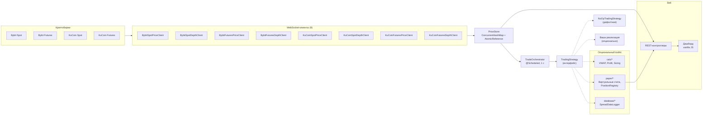

# crypto — сборщик рыночных данных криптобирж в реальном времени

🇬🇧 [English version](README.en.md)

> Многопоточный сборщик рыночных данных с бирж **Bybit** и **KuCoin**
> с подключаемой торговой стратегией:
> 8 каналов WebSocket, ~400 соединений, ~2 800 сообщений/с, p95 задержки меньше 0,4 мс.

[](https://openjdk.org/projects/jdk/21/)
[](https://spring.io/projects/spring-boot)
[](./LICENSE)

---

## Содержание

- [О проекте](#о-проекте)
- [Возможности](#возможности)
- [Архитектура](#архитектура)
- [Технологии](#технологии)
- [Ключевые метрики](#ключевые-метрики)
- [Запуск](#запуск)
- [Конфигурация](#конфигурация)
- [API](#api)
- [Структура проекта](#структура-проекта)
- [Как подключить свою стратегию](#как-подключить-свою-стратегию)
- [Ключевые технические решения](#ключевые-технические-решения)
- [Планы](#планы)
- [Лицензия](#лицензия)

---

## О проекте

**crypto** — промышленный сборщик рыночных данных. Он подписывается
на потоки цен и стаканов двух криптобирж одновременно и поддерживает
согласованный снимок рынка в памяти.

Проект начинался как полноценный арбитражный торговый бот. Торговая стратегия
намеренно удалена и заменена точкой расширения — интерфейсом
`TradingStrategy`. Всё, что связано с рыночными данными, интеграцией с биржами
и инфраструктурой, осталось. Пользователь подключает свою стратегию, не трогая
низкоуровневый слой.

**Ценность проекта — в инфраструктуре вокруг стратегии:**

- Параллельная обработка данных по 8 каналам и ~400 соединениям WebSocket
- Хранилище цен в памяти без блокировок на базе `ConcurrentHashMap` + `AtomicReference`
- Подписанные REST-клиенты для Bybit v5 и KuCoin v3 / Futures v1
- Кэш точности инструментов и кэш ставок займа для маржинальных операций
- Опциональный toolkit для paper-торговли: виртуальные балансы, учёт долга, реестр позиций, расчёт PnL
- Хранение снимков спредов в PostgreSQL (`jsonb`-стаканы) — опциональный `DatabaseSpreadLogger`
- REST API для состояния рынка и простой дашборд
- Низкая нагрузка на CPU: 0,16 ядра при ~2 800 сообщений/с

---

## Возможности

- **Рыночные данные в реальном времени** по 8 каналам WebSocket:
  Bybit спот/фьючерсы × цена/стакан, KuCoin спот/фьючерсы × цена/стакан
- **151 торговая пара** отслеживается одновременно
- **~400 WebSocket-соединений** с подпиской чанками по 3 символа
- **Автоматическое переподключение** с блокировкой на уровне чанка и 30-секундным watchdog
- **Периодический ping** каждые 15 секунд на каждое соединение
- **Плановый перезапуск WS** каждые 12 часов для защиты от утечек памяти
- **Хранилище цен в памяти** с ключом `exchange:symbol` и чтением без блокировок
- **Подписанные REST-клиенты** для Bybit (HMAC-SHA256, hex) и KuCoin (HMAC-SHA256, base64)
- **Кэш точности инструментов** — размер лота / шаг количества запрашивается один раз на символ
- **Кэш ставок займа** для маржинальных кредитов Bybit (TTL 60 секунд)
- **Точка расширения** — интерфейс `TradingStrategy` с дефолтной `NoOpTradingStrategy`
- **Опциональный toolkit для paper-торговли**: виртуальные счета, учёт долга, реестр позиций, расчёт PnL по VWAP
- **REST API** для балансов, открытых позиций и кандидатов
- **Дашборд в реальном времени** (чистый JS, без сборки), опрос раз в секунду
- **Spring Boot Actuator** для health-проверок и метрик

---

## Архитектура



### Поток данных

1. 8 WebSocket-клиентов подключаются к публичным потокам Bybit и KuCoin.
2. Каждый клиент делит свой список символов на чанки по 3 и открывает по одному
   WS-соединению на чанк.
3. Входящие сообщения разбираются и записываются в `PriceStore`.
4. `TradeOrchestrator.tick()` запускается каждую секунду и для каждой пары
   проверяет, что все четыре тика (Bybit spot/futures, KuCoin spot/futures)
   получены не более 10 секунд назад. Если да — вызывает
   `strategy.onTick(symbol, bybitSpot, bybitFut, kucoinSpot, kucoinFut)`.
5. Реализация `TradingStrategy` решает, что делать с данными. Дефолтная
   `NoOpTradingStrategy` ничего не делает.
6. REST-контроллеры отдают состояние дашборду.

`TradeOrchestrator` не содержит торговой логики. Он не считает спреды,
не определяет размеры позиций, не исполняет сделки — только доставляет
свежие рыночные данные стратегии.

---

## Технологии

| Область | Технологии |
|---|---|
| Язык | Java 21 (records, switch-выражения) |
| Фреймворк | Spring Boot 4.1.0 |
| Веб-слой | Spring MVC на Tomcat 11 |
| WebSocket | `java.net.http.WebSocket` (без внешних клиентов) |
| База данных | PostgreSQL 16 через `JdbcTemplate` |
| JSON | Gson 2.11 |
| HMAC | Apache Commons Codec |
| Шаблонный код | Lombok |
| Наблюдаемость | Spring Boot Actuator, Micrometer |
| Фронтенд | Чистые HTML/CSS/JS, без сборки |
| Сборка | Maven |

---

## Ключевые метрики

Замерено на живом экземпляре (Windows, JDK 21.0.6, Spring Boot 4.1.0)
на предыдущей сборке проекта — до того как стратегия была заменена заглушкой.
Во время рефакторинга WebSocket-инфраструктура, `PriceStore` и клиенты бирж
не изменялись, поэтому приведённые цифры по-прежнему применимы.

| Метрика | Значение |
|---|---|
| WebSocket-соединения | 400 |
| Пропускная способность | ~2 800 сообщений/с |
| Задержка сообщения, p95 | 0,34 мс |
| Задержка сообщения, p50 | ~0,18 мс |
| Куча (heap) | 153 МБ (из 268 МБ) |
| Metaspace | 62 МБ |
| CPU | 0,16 ядра |
| Живые потоки | 160 |
| Full GC | 0 за прогон |
| Частота Young GC | ~0,9 / с |
| Пауза Young GC | ~3,3 мс |

**Как проводились измерения:**

- WS-соединения — `Get-NetTCPConnection -OwningProcess <pid>`
- Пропускная способность — Arthas `monitor -c 10 <Client> handleMessage` по 8 клиентам
- Задержка — Arthas `trace -n 100` на самом нагруженном канале
- Heap / GC — `jcmd GC.heap_info`, `jstat -gcutil`
- CPU — разница `Get-Process` за 10 секунд
- Потоки — `jstack`

Кода для сбора собственных метрик в приложение не добавлялось: все цифры
получены внешними JVM-инструментами.

---

## Запуск

### Требования

- JDK 21
- Maven 3.9+
- PostgreSQL 16 (или Docker) — опционально, нужен только если хотите писать
  снимки спредов в БД

### 1. Запустите PostgreSQL (опционально)

```bash
docker run -d --name pg-marketdata \
  -p 5432:5432 \
  -e POSTGRES_PASSWORD=postgres \
  postgres:16
```

Создайте схему:

```sql
CREATE TABLE spread_data (
  id BIGSERIAL PRIMARY KEY,
  symbol TEXT,
  side TEXT,
  ts TIMESTAMPTZ,
  bybit_futures_bid DOUBLE PRECISION,
  bybit_futures_ask DOUBLE PRECISION,
  bybit_futures_bids JSONB,
  bybit_futures_asks JSONB,
  kucoin_spot_bid DOUBLE PRECISION,
  kucoin_spot_ask DOUBLE PRECISION,
  kucoin_spot_bids JSONB,
  kucoin_spot_asks JSONB,
  net_spread_percent DOUBLE PRECISION
);
```

Если пропустить этот шаг, приложение запустится, но health-индикатор БД
будет в состоянии `DOWN`.

### 2. Задайте переменные окружения

```bash
export DB_PASSWORD=postgres
export BYBIT_API_KEY=your_key
export BYBIT_API_SECRET=your_secret
export KUCOIN_API_KEY=your_key
export KUCOIN_API_SECRET=your_secret
export KUCOIN_API_PASSPHRASE=your_passphrase
```

API-ключи бирж нужны только подписанным REST-клиентам и не используются
публичной сборкой в горячем пути. WebSocket-потоки публичные и работают без
ключей.

### 3. Запустите приложение

```bash
mvn spring-boot:run
```

### 4. Откройте дашборд

```text
http://localhost:8088
```

---

## Конфигурация

Все секретные и связанные со стратегией значения передаются через переменные
окружения. Значения по умолчанию в `application.yml` намеренно нейтральны.

| Переменная | По умолчанию | Описание |
|---|---|---|
| `SERVER_PORT` | `8088` | HTTP-порт |
| `DB_URL` | `jdbc:postgresql://localhost:5432/postgres` | JDBC URL |
| `DB_USERNAME` | `postgres` | Пользователь БД |
| `DB_PASSWORD` | `postgres` | Пароль БД |
| `BYBIT_API_KEY` | — | API-ключ Bybit |
| `BYBIT_API_SECRET` | — | API-секрет Bybit |
| `KUCOIN_API_KEY` | — | API-ключ KuCoin |
| `KUCOIN_API_SECRET` | — | API-секрет KuCoin |
| `KUCOIN_API_PASSPHRASE` | — | Парольная фраза KuCoin API |
| `WS_RESTART_MINUTES` | `720` | Интервал планового перезапуска WebSocket |
| `TEST_MODE_ENABLED` | `false` | Включить синтетические тестовые пары |
| `PAPER_INITIAL_USDT_BYBIT` | `1000` | Виртуальный баланс Bybit |
| `PAPER_INITIAL_USDT_KUCOIN` | `1000` | Виртуальный баланс KuCoin |

Полный шаблон настроек: [`application-example.yml`](src/main/resources/application-example.yml).

---

## API

| Метод | Путь | Описание |
|---|---|---|
| GET | `/api/balances` | Чистая стоимость по обеим биржам и общее изменение |
| GET | `/api/positions` | Открытые позиции с нереализованным PnL |
| GET | `/api/candidates` | Пары, отмеченные стратегией как кандидаты |
| POST | `/api/manual-entry` | Ручной вход — отключён в публичной сборке |
| GET | `/actuator/health` | Состояние приложения |

`/api/balances`, `/api/positions` и `/api/candidates` работают и в публичной
сборке, но их значения определяются стратегией. С дефолтной
`NoOpTradingStrategy` позиции и кандидаты всегда пусты, а балансы показывают
стартовые виртуальные суммы.

Дашборд по адресу `/` опрашивает три GET-эндпоинта (`/api/balances`,
`/api/positions`, `/api/candidates`) раз в секунду.

---

## Структура проекта

```text
prodSecond/
├── src/main/java/com/MySelfAlgoWithLoan/prod/
│   ├── ProdApplication.java
│   ├── api/
│   │   ├── ws/              # 8 WebSocket-клиентов + WsClientBase
│   │   ├── bybit/           # Подписанные REST-клиенты (ордера, займы, точность)
│   │   └── kucoin/          # Подписанные REST-клиенты (спот + фьючерсы)
│   ├── calc/                # VWAP, расчёт прибыли, размера позиции, долга
│   ├── config/              # Properties
│   ├── database/            # SpreadDataRepository + пакетный логгер
│   ├── domain/              # MarketTick
│   ├── marketdata/          # PriceStore
│   ├── orchestrator/        # TradeOrchestrator (@Scheduled tick)
│   ├── paper/               # Виртуальные счета, реестр позиций, исполнитель
│   ├── scheduler/           # Перезапуск WS, диагностика PriceStore
│   ├── service/             # MarketDataStartupRunner
│   ├── simulator/           # TestScenarioSimulator (только тестовый режим)
│   ├── strategy/            # TradingStrategy interface + NoOpTradingStrategy
│   ├── util/                # SymbolFormat
│   └── web/                 # REST-контроллеры + дашборд
├── src/main/resources/
│   ├── application.yml
│   ├── application-example.yml
│   └── static/              # index.html, app.js, style.css
├── pom.xml
├── LICENSE
└── README.md
```

---

## Как подключить свою стратегию

Единственное, что нужно, — реализовать интерфейс `TradingStrategy`.

```java
package com.example.mystrategy;

import com.MySelfAlgoWithLoan.prod.domain.MarketTick;
import com.MySelfAlgoWithLoan.prod.strategy.TradingStrategy;
import org.springframework.stereotype.Component;

@Component
public class MyStrategy implements TradingStrategy {

    @Override
    public void onTick(String symbol,
                       MarketTick bybitSpot,
                       MarketTick bybitFut,
                       MarketTick kucoinSpot,
                       MarketTick kucoinFut) {
        double spread = bybitFut.bid() / kucoinSpot.ask() - 1;
        if (spread > 0.01) {
            // ваша логика
        }
    }
}
```

`NoOpTradingStrategy` помечена `@ConditionalOnMissingBean(TradingStrategy.class)`
и автоматически отключается, как только в контексте появляется другой бин
`TradingStrategy`.

**Что доступно из коробки для реализации стратегии:**

- `PriceStore` — доступ к актуальным тикам по любому символу
- `calc/VwapCalculator`, `calc/ProfitCalculator`, `calc/PositionSizeCalculator` —
  готовые расчёты VWAP, PnL и размера позиции по стакану
- `paper/PaperTradeExecutor`, `paper/VirtualAccountBook`,
  `paper/PositionRegistry` — виртуальные счета, исполнение бумажных сделок,
  реестр открытых позиций
- `database/DatabaseSpreadLogger` — опциональная пакетная запись снимков
  спредов в PostgreSQL
- `api/bybit/*`, `api/kucoin/*` — подписанные REST-клиенты для реального
  исполнения ордеров

Стратегия сама решает, что использовать. Минимальная реализация — только
`onTick` с логированием; полная — с реальным исполнением через REST-клиенты.

---

## Ключевые технические решения

**Подписка на WebSocket чанками.** Каждый клиент делит список символов на
чанки по 3 и открывает по одному соединению на чанк. Это обмен числа
соединений на простоту: нет управления подписками и перебалансировки по
символам, а блокировка на уровне чанка упрощает рассуждения о переподключениях.

**Хранилище цен без блокировок.** `ConcurrentHashMap<String, AtomicReference<MarketTick>>`
даёт чтение без ожидания на горячем пути. Писатели используют `updateAndGet`,
поэтому обновления цен и стаканов никогда не блокируют читателей.

**Раздельные каналы цен и стакана.** И Bybit, и KuCoin публикуют тикер и
стакан в разных топиках. Раздельная обработка позволяет сборщику корректно
деградировать, если стакан недоступен.

**Пакетная запись в БД.** `DatabaseSpreadLogger` накапливает записи в
`ConcurrentLinkedQueue` и сбрасывает их каждые 2 секунды. Так PostgreSQL
остаётся вне горячего пути. В публичной сборке очередь заполняется только
если пользовательская стратегия вызывает `enqueue()`.

**Точка расширения вместо стратегии.** `TradingStrategy` — единственный
интерфейс, который нужно реализовать. `TradeOrchestrator` доставляет в него
свежие данные, но не содержит ни одной строки торговой логики.

**Виртуальная книга счетов.** `paper/VirtualExchangeAccount` раздельно
учитывает балансы и долг. Это повторяет работу маржинальных займов на реальной
бирже и делает расчёт PnL согласованным. Toolkit опциональный — стратегия
может его не использовать.

**Без внешней библиотеки WebSocket.** Используется напрямую
`java.net.http.WebSocket`. Это сокращает дерево зависимостей и избавляет от
проблем жизненного цикла, зависящих от фреймворка.

**Плановый перезапуск WebSocket.** `MarketDataRestartScheduler` каждые 12 часов
закрывает и заново создаёт все соединения, чтобы избежать накопления утечек.

---

## Лицензия

Проект распространяется по лицензии MIT — подробности в файле [LICENSE](./LICENSE).