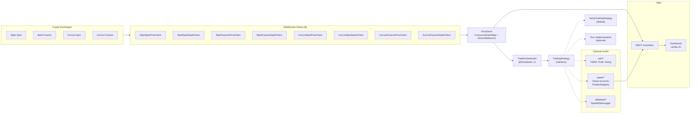

# crypto — Real-Time Crypto Market Data Collector

🇷🇺 [Русская версия](README.md)

> Multi-threaded market data collector for **Bybit** and **KuCoin**
> with a pluggable trading strategy:
> 8 WebSocket channels, ~400 connections, ~2,800 messages/sec, p95 latency under 0.4 ms.

[](https://openjdk.org/projects/jdk/21/)
[](https://spring.io/projects/spring-boot)
[](./LICENSE)

---

## Table of Contents

- [About](#about)
- [Features](#features)
- [Architecture](#architecture)
- [Tech Stack](#tech-stack)
- [Key Metrics](#key-metrics)
- [How to Run](#how-to-run)
- [Configuration](#configuration)
- [API Endpoints](#api-endpoints)
- [Project Structure](#project-structure)
- [Plugging in Your Own Strategy](#plugging-in-your-own-strategy)
- [Key Technical Decisions](#key-technical-decisions)
- [Roadmap](#roadmap)
- [License](#license)

---

## About

**crypto** is a production-grade market data collector. It subscribes to
real-time price and order book feeds from two crypto exchanges simultaneously
and keeps a consistent in-memory view of the market.

The project started as a full arbitrage trading bot. The trading strategy has
been intentionally removed and replaced with an extension point — the
`TradingStrategy` interface. Everything related to market data, exchange
integration, and infrastructure has been kept. Users plug in their own
strategy without touching the low-level layer.

**The value of this project is the infrastructure around the strategy:**

- Concurrent WebSocket fan-out across 8 channels and ~400 connections
- Lock-free in-memory price store built on `ConcurrentHashMap` + `AtomicReference`
- Signed REST clients for Bybit v5 and KuCoin v3 / Futures v1
- Instrument precision cache and borrow rate cache for margin operations
- Optional paper-trading toolkit: virtual balances, debt tracking, position registry, PnL calculation
- Spread snapshot persistence in PostgreSQL (`jsonb` order books) via the optional `DatabaseSpreadLogger`
- REST API for market state and a simple dashboard
- Low CPU footprint: 0.16 core at ~2,800 msg/sec

---

## Features

- **Real-time market data** from 8 WebSocket channels:
  Bybit spot/futures × price/depth, KuCoin spot/futures × price/depth
- **151 trading pairs** subscribed simultaneously
- **~400 WebSocket connections** managed with chunked subscriptions of 3 symbols
- **Automatic reconnect** with chunk-level locking and a 30-second watchdog
- **Periodic ping** every 15 seconds per connection
- **Planned WS restart** every 12 hours to avoid memory leaks
- **In-memory price store** keyed by `exchange:symbol` with lock-free reads
- **Signed REST clients** for Bybit (HMAC-SHA256, hex) and KuCoin (HMAC-SHA256, base64)
- **Instrument precision cache** — lot size / base increment fetched once per symbol
- **Borrow rate cache** for Bybit margin loans (60-second TTL)
- **Extension point** — the `TradingStrategy` interface with a default `NoOpTradingStrategy`
- **Optional paper-trading toolkit**: virtual accounts, debt tracking, position registry, VWAP-based PnL
- **REST API** for balances, open positions, and candidates
- **Live dashboard** (vanilla JS, no build step) polling every second
- **Spring Boot Actuator** for health and metrics

---

## Architecture



### Data flow

1. 8 WebSocket clients connect to Bybit and KuCoin public streams.
2. Each client splits its symbol list into chunks of 3 and opens one WS
   connection per chunk.
3. Incoming messages are parsed and written to the `PriceStore`.
4. `TradeOrchestrator.tick()` runs every second and, for each pair, checks that
   all four ticks (Bybit spot/futures, KuCoin spot/futures) were received no
   more than 10 seconds ago. If so, it calls
   `strategy.onTick(symbol, bybitSpot, bybitFut, kucoinSpot, kucoinFut)`.
5. The `TradingStrategy` implementation decides what to do with the data. The
   default `NoOpTradingStrategy` does nothing.
6. REST controllers expose the state to the dashboard.

`TradeOrchestrator` contains no trading logic. It does not compute spreads,
size positions, or execute trades — it only delivers fresh market data to the
strategy.

---

## Tech Stack

| Area | Technologies |
|---|---|
| Language | Java 21 (records, switch expressions) |
| Framework | Spring Boot 4.1.0 |
| Web layer | Spring MVC on Tomcat 11 |
| WebSocket | `java.net.http.WebSocket` (no external client) |
| Database | PostgreSQL 16 via `JdbcTemplate` |
| JSON | Gson 2.11 |
| HMAC | Apache Commons Codec |
| Boilerplate | Lombok |
| Observability | Spring Boot Actuator, Micrometer |
| Frontend | Vanilla HTML/CSS/JS, no build step |
| Build | Maven |

---

## Key Metrics

Measured on a live instance (Windows, JDK 21.0.6, Spring Boot 4.1.0) on the
previous build of the project — before the strategy was replaced with a stub.
During the refactoring, the WebSocket infrastructure, `PriceStore`, and the
exchange clients were not changed, so these numbers still apply.

| Metric | Value |
|---|---|
| WebSocket connections | 400 |
| Throughput | ~2,800 messages / sec |
| p95 message latency | 0.34 ms |
| p50 message latency | ~0.18 ms |
| Heap used | 153 MB (of 268 MB) |
| Metaspace | 62 MB |
| CPU | 0.16 core |
| Live threads | 160 |
| Full GC | 0 during run |
| Young GC rate | ~0.9 / sec |
| Young GC pause | ~3.3 ms |

**How these were measured:**

- WS connections — `Get-NetTCPConnection -OwningProcess <pid>`
- Throughput — Arthas `monitor -c 10 <Client> handleMessage` across 8 clients
- Latency — Arthas `trace -n 100` on the busiest channel
- Heap / GC — `jcmd GC.heap_info`, `jstat -gcutil`
- CPU — `Get-Process` delta over 10 seconds
- Threads — `jstack`

No custom metrics code was added to the application; all numbers come from
external JVM tools.

---

## How to Run

### Requirements

- JDK 21
- Maven 3.9+
- PostgreSQL 16 (or Docker) — optional, only needed if you want to store
  spread snapshots in the database

### 1. Start PostgreSQL (optional)

```bash
docker run -d --name pg-marketdata \
  -p 5432:5432 \
  -e POSTGRES_PASSWORD=postgres \
  postgres:16
```

Create the schema:

```sql
CREATE TABLE spread_data (
  id BIGSERIAL PRIMARY KEY,
  symbol TEXT,
  side TEXT,
  ts TIMESTAMPTZ,
  bybit_futures_bid DOUBLE PRECISION,
  bybit_futures_ask DOUBLE PRECISION,
  bybit_futures_bids JSONB,
  bybit_futures_asks JSONB,
  kucoin_spot_bid DOUBLE PRECISION,
  kucoin_spot_ask DOUBLE PRECISION,
  kucoin_spot_bids JSONB,
  kucoin_spot_asks JSONB,
  net_spread_percent DOUBLE PRECISION
);
```

If you skip this step, the application will start, but the database health
indicator will be `DOWN`.

### 2. Configure environment variables

```bash
export DB_PASSWORD=postgres
export BYBIT_API_KEY=your_key
export BYBIT_API_SECRET=your_secret
export KUCOIN_API_KEY=your_key
export KUCOIN_API_SECRET=your_secret
export KUCOIN_API_PASSPHRASE=your_passphrase
```

Exchange API keys are only needed by the signed REST clients and are not used
by the public build on the hot path. The WebSocket streams are public and work
without keys.

### 3. Run the application

```bash
mvn spring-boot:run
```

### 4. Open the dashboard

```text
http://localhost:8088
```

---

## Configuration

All sensitive and strategy-specific values are supplied via environment
variables. Defaults in `application.yml` are intentionally neutral.

| Variable | Default | Description |
|---|---|---|
| `SERVER_PORT` | `8088` | HTTP port |
| `DB_URL` | `jdbc:postgresql://localhost:5432/postgres` | JDBC URL |
| `DB_USERNAME` | `postgres` | Database user |
| `DB_PASSWORD` | `postgres` | Database password |
| `BYBIT_API_KEY` | — | Bybit API key |
| `BYBIT_API_SECRET` | — | Bybit API secret |
| `KUCOIN_API_KEY` | — | KuCoin API key |
| `KUCOIN_API_SECRET` | — | KuCoin API secret |
| `KUCOIN_API_PASSPHRASE` | — | KuCoin API passphrase |
| `WS_RESTART_MINUTES` | `720` | Planned WebSocket restart interval |
| `TEST_MODE_ENABLED` | `false` | Enable synthetic test pairs |
| `PAPER_INITIAL_USDT_BYBIT` | `1000` | Virtual Bybit balance |
| `PAPER_INITIAL_USDT_KUCOIN` | `1000` | Virtual KuCoin balance |

See [`application-example.yml`](src/main/resources/application-example.yml)
for a full template.

---

## API Endpoints

| Method | Path | Description |
|---|---|---|
| GET | `/api/balances` | Net worth for both exchanges and total change |
| GET | `/api/positions` | Open positions with unrealized PnL |
| GET | `/api/candidates` | Pairs flagged by the strategy as candidates |
| POST | `/api/manual-entry` | Manual entry — disabled in the public build |
| GET | `/actuator/health` | Application health |

`/api/balances`, `/api/positions`, and `/api/candidates` work in the public
build too, but their values are determined by the strategy. With the default
`NoOpTradingStrategy`, positions and candidates are always empty, and balances
show the initial virtual amounts.

The dashboard at `/` polls the three GET endpoints (`/api/balances`,
`/api/positions`, `/api/candidates`) every second.

---

## Project Structure

```text
prodSecond/
├── src/main/java/com/MySelfAlgoWithLoan/prod/
│   ├── ProdApplication.java
│   ├── api/
│   │   ├── ws/              # 8 WebSocket clients + WsClientBase
│   │   ├── bybit/           # Signed REST clients (orders, borrow, precision)
│   │   └── kucoin/          # Signed REST clients (spot + futures)
│   ├── calc/                # VWAP, profit, position size, debt calculations
│   ├── config/              # Properties
│   ├── database/            # SpreadDataRepository + batched logger
│   ├── domain/              # MarketTick
│   ├── marketdata/          # PriceStore
│   ├── orchestrator/        # TradeOrchestrator (@Scheduled tick)
│   ├── paper/               # Virtual accounts, position registry, executor
│   ├── scheduler/           # WS restart, price-store diagnostics
│   ├── service/             # MarketDataStartupRunner
│   ├── simulator/           # TestScenarioSimulator (test mode only)
│   ├── strategy/            # TradingStrategy interface + NoOpTradingStrategy
│   ├── util/                # SymbolFormat
│   └── web/                 # REST controllers + dashboard
├── src/main/resources/
│   ├── application.yml
│   ├── application-example.yml
│   └── static/              # index.html, app.js, style.css
├── pom.xml
├── LICENSE
└── README.md
```

---

## Plugging in Your Own Strategy

All you need to do is implement the `TradingStrategy` interface.

```java
package com.example.mystrategy;

import com.MySelfAlgoWithLoan.prod.domain.MarketTick;
import com.MySelfAlgoWithLoan.prod.strategy.TradingStrategy;
import org.springframework.stereotype.Component;

@Component
public class MyStrategy implements TradingStrategy {

    @Override
    public void onTick(String symbol,
                       MarketTick bybitSpot,
                       MarketTick bybitFut,
                       MarketTick kucoinSpot,
                       MarketTick kucoinFut) {
        double spread = bybitFut.bid() / kucoinSpot.ask() - 1;
        if (spread > 0.01) {
            // your logic
        }
    }
}
```

`NoOpTradingStrategy` is annotated with `@ConditionalOnMissingBean(TradingStrategy.class)`
and is automatically disabled as soon as another `TradingStrategy` bean appears
in the context.

**What is available out of the box for building a strategy:**

- `PriceStore` — access to the latest ticks for any symbol
- `calc/VwapCalculator`, `calc/ProfitCalculator`, `calc/PositionSizeCalculator` —
  ready-made VWAP, PnL, and order-book-based position sizing
- `paper/PaperTradeExecutor`, `paper/VirtualAccountBook`,
  `paper/PositionRegistry` — virtual accounts, paper trade execution,
  open position registry
- `database/DatabaseSpreadLogger` — optional batched writing of spread
  snapshots to PostgreSQL
- `api/bybit/*`, `api/kucoin/*` — signed REST clients for real order execution

The strategy decides what to use. A minimal implementation is just `onTick`
with logging; a full one executes real orders through the REST clients.

---

## Key Technical Decisions

**Chunked WebSocket subscriptions.** Each client splits its symbol list into
chunks of 3 and opens one connection per chunk. This trades connection count
for simplicity: no subscription management, no per-symbol rebalancing, and
chunk-level locking makes reconnects easy to reason about.

**Lock-free price store.** `ConcurrentHashMap<String, AtomicReference<MarketTick>>`
gives wait-free reads on the hot path. Writers use `updateAndGet`, so price
and order book updates never block readers.

**Separate price and depth channels.** Bybit and KuCoin both publish ticker and
order book on different topics. Keeping them separate lets the collector
degrade gracefully if depth is unavailable.

**Batched database writes.** `DatabaseSpreadLogger` accumulates records in a
`ConcurrentLinkedQueue` and flushes every 2 seconds. This keeps PostgreSQL
out of the hot path. In the public build, the queue is only filled if a user
strategy calls `enqueue()`.

**Extension point instead of a strategy.** `TradingStrategy` is the only
interface you need to implement. `TradeOrchestrator` delivers fresh data to it
but contains not a single line of trading logic.

**Virtual account book.** `paper/VirtualExchangeAccount` tracks balances and
debt separately. This mirrors how margin loans work on a real exchange and
makes PnL calculations consistent. The toolkit is optional — a strategy may
not use it at all.

**No external WebSocket library.** `java.net.http.WebSocket` is used directly.
This keeps the dependency tree small and avoids framework-specific lifecycle
issues.

**Planned WebSocket restart.** `MarketDataRestartScheduler` tears down and
re-creates all connections every 12 hours to avoid long-running leaks.

---

## License

This project is licensed under the MIT License — see the [LICENSE](./LICENSE) file
for details.